# Power Pulse

<p align="center">
  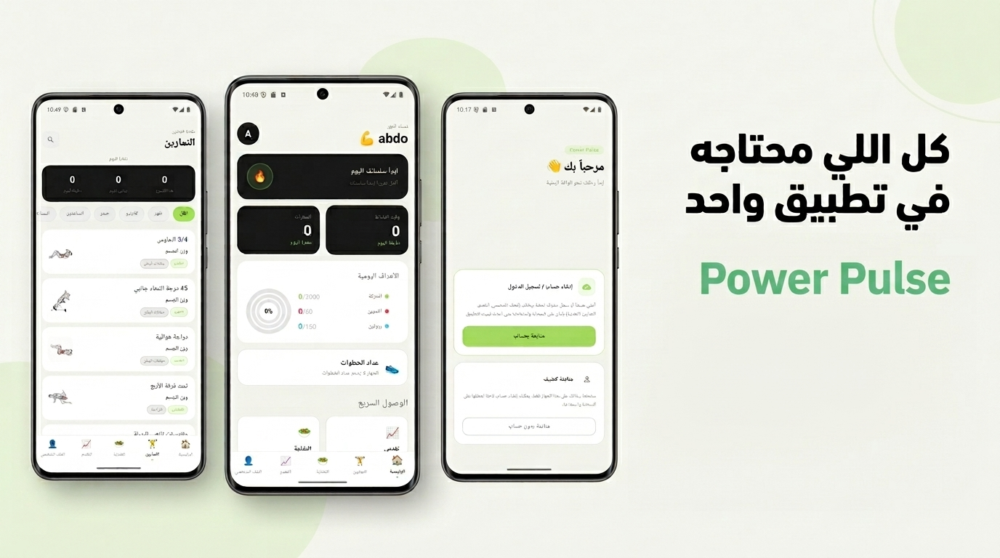
</p>

Power Pulse is a Flutter fitness application built for Android. It covers workout planning and logging, calorie and macro tracking, body progress monitoring, and a built-in step counter — all usable offline as a guest or synced to the cloud after creating an account. The app is fully localized in Arabic and English with right-to-left layout support.

---

## Screenshots

<table>
  <tr>
    <td align="center">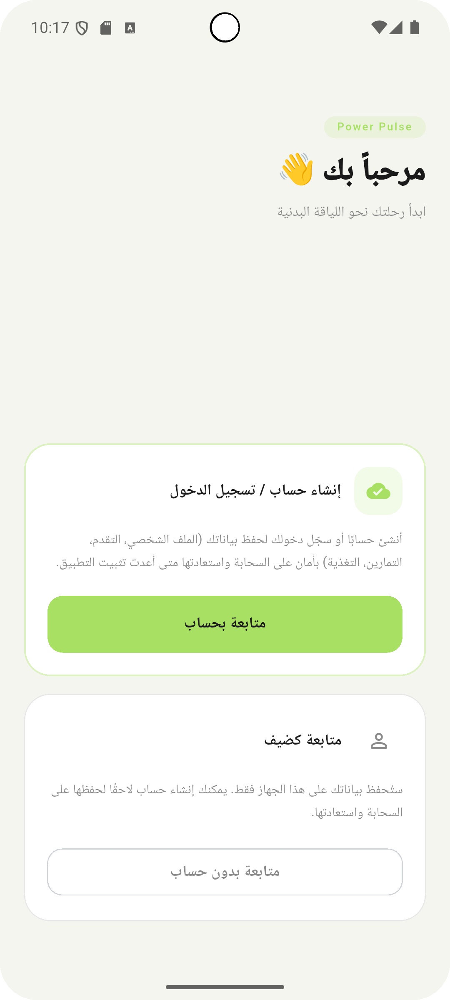<br><sub>Entry / Landing</sub></td>
    <td align="center">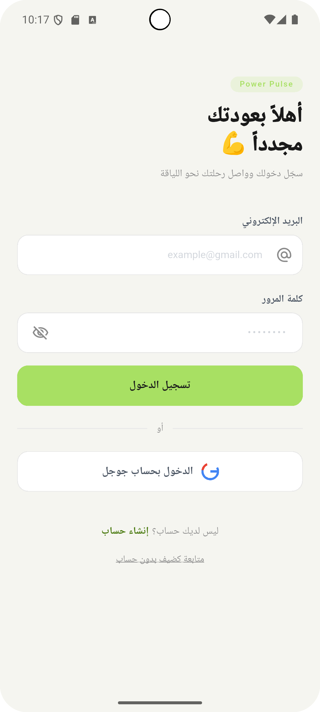<br><sub>Sign In</sub></td>
    <td align="center">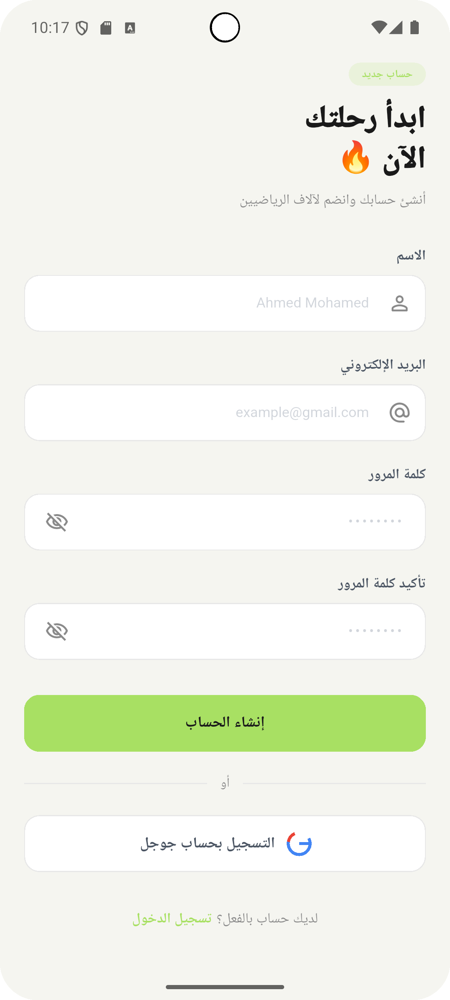<br><sub>Sign Up</sub></td>
    <td align="center"><br><sub>Onboarding</sub></td>
  </tr>
  <tr>
    <td align="center">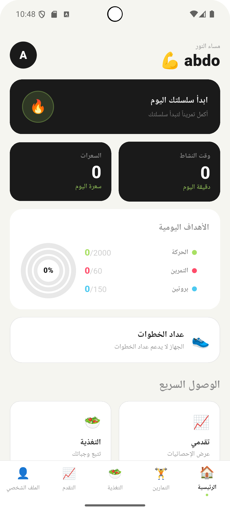<br><sub>Home Dashboard</sub></td>
    <td align="center">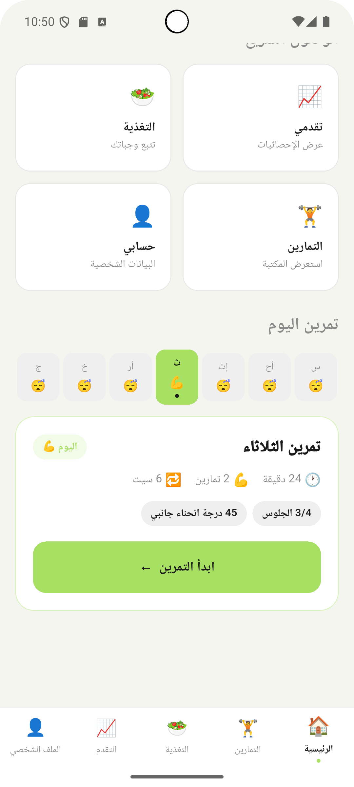<br><sub>Home — Daily Goals</sub></td>
    <td align="center">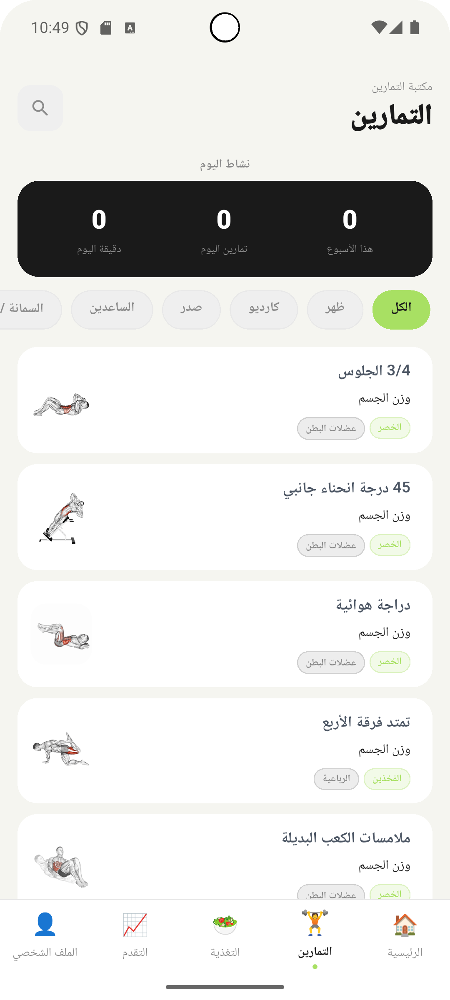<br><sub>Exercise Library</sub></td>
    <td align="center"><br><sub>Workout Logger</sub></td>
  </tr>
  <tr>
    <td align="center">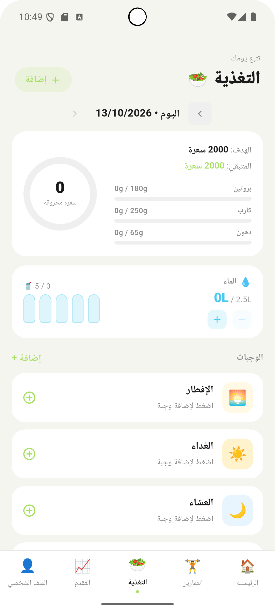<br><sub>Workout Plan</sub></td>
    <td align="center">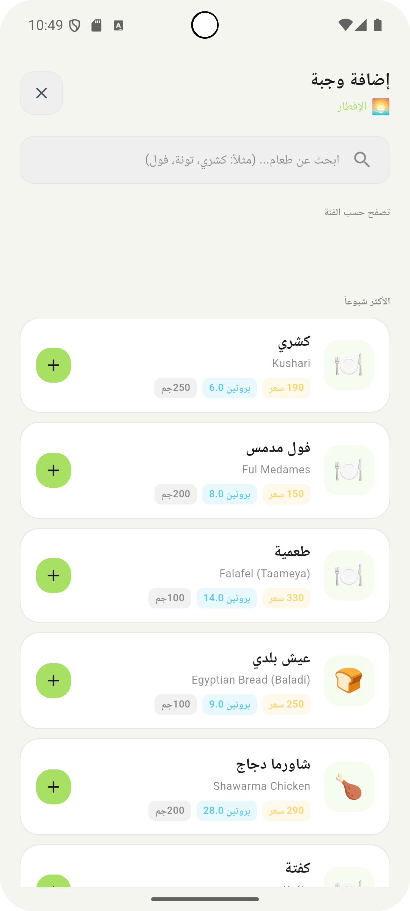<br><sub>Add Food</sub></td>
    <td align="center">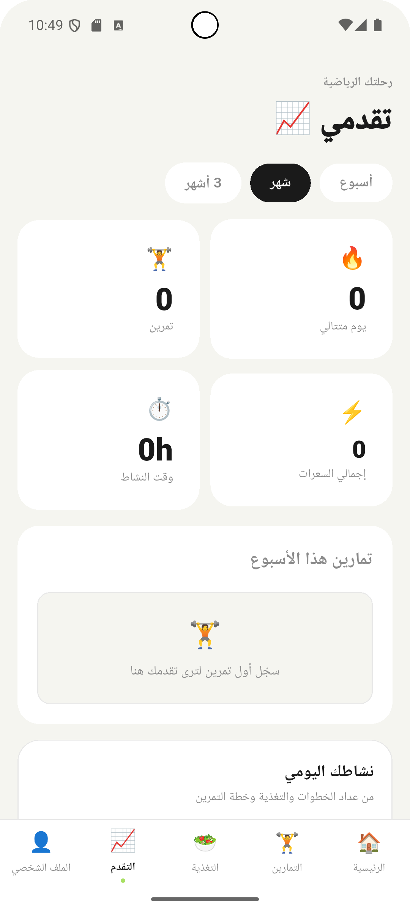<br><sub>Progress</sub></td>
    <td align="center">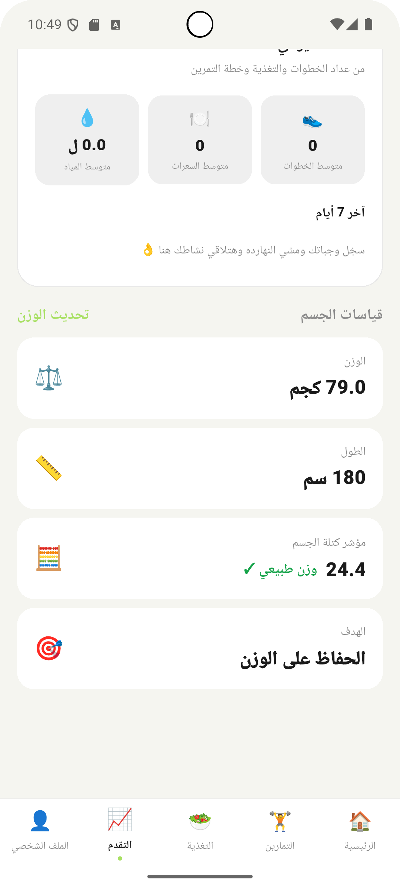<br><sub>Progress Charts</sub></td>
  </tr>
  <tr>
    <td align="center">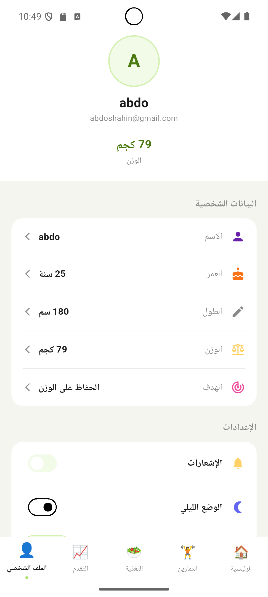<br><sub>Profile</sub></td>
    <td align="center">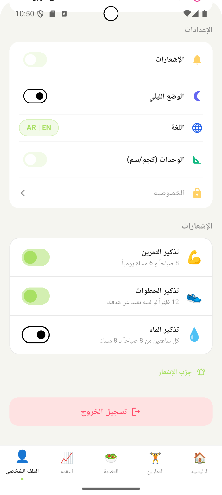<br><sub>Profile Settings</sub></td>
    <td></td>
    <td></td>
  </tr>
</table>

---

## Features

### Authentication
- Email/password sign-in and registration via Supabase Auth
- Google OAuth sign-in
- Password reset via deep link
- **Guest mode** — use the app with full local functionality without an account; data migrates to the cloud automatically when you later sign in

### Home Dashboard
- Daily calorie and active-time summary cards
- Step counter card (live, sourced from device pedometer sensor)
- Workout streak tracker
- Today's workout shortcut based on the active weekly plan

### Exercise Library
- Exercises organized by body part (chest, lats, arms, legs, core, and more)
- Animated GIF demonstrations
- Search with instant results
- Exercise detail screen with muscle group info and sets/reps stats
- Add any exercise directly to your workout plan from the detail screen

### Workout Planning
- Weekly plan builder — assign exercises to each day
- Exercise picker with search, filtered by body part
- Plan persists locally and syncs to Supabase when signed in

### Workout Logger
- Start and track a live workout session
- Add exercises and log sets with weight and reps
- Finish a session to see a workout summary sheet
- Session history stored locally and synced to the cloud

### Nutrition Tracking
- Log meals across four meal types: breakfast, lunch, dinner, and snacks
- Real-time calorie and macronutrient breakdown (protein, carbs, fat)
- Food search powered by the Open Food Facts API, prioritizing Egyptian products, with a built-in local Arabic/Egyptian food database as a fallback
- Water intake tracking with daily goal
- Day-by-day navigation to review past logs

### Progress & Body Stats
- Weekly activity chart
- Body stats section (weight, BMI, BMR, TDEE — calculated from onboarding profile)
- Weight entry log with history
- Period selector for weekly/monthly views

### Pedometer
- Live step count displayed on the home screen
- Uses the device's hardware step sensor via the `pedometer` package
- Permissions requested at runtime

### Notifications
- Configurable local push notifications for workout reminders (morning and evening), step reminders, and hourly water reminders
- Notification channels for each category; all toggleable from the profile settings screen
- Scheduled using `flutter_local_notifications` with timezone-aware timing

### Settings & Personalization
- Dark mode and light mode (system-aware default)
- Language toggle between Arabic (RTL) and English (LTR)
- Profile editing (name, age, height, weight, fitness goal, activity level)

---

## Tech Stack

| Category | Details |
|---|---|
| **Framework** | Flutter 3.32.5 / Dart SDK ^3.5.0 |
| **State management** | flutter_bloc (Cubit pattern) |
| **Backend** | Supabase (authentication + cloud data storage) |
| **Dependency injection** | GetIt |
| **Navigation** | GoRouter (with ShellRoute for the bottom-nav shell) |
| **HTTP client** | Dio |
| **Local storage** | SharedPreferences |
| **Responsive layout** | flutter_screenutil (design reference: 375 × 812) |
| **Notifications** | flutter_local_notifications + timezone |
| **Step counter** | pedometer |
| **Image caching** | cached_network_image |
| **SVG rendering** | flutter_svg |
| **Localization** | flutter_localizations + custom JSON delegate |
| **Connectivity** | connectivity_plus |
| **External APIs** | Open Food Facts (nutrition search), CDN-hosted exercise JSON + GIF media |

---

## Architecture

The project uses a **feature-based modular structure**. Each feature has three consistent layers:

- `data/` — models (entities + API/JSON mapping), services (data sources), and repositories
- `logic/` — Cubits, states, and use-case classes
- `ui/` — screens and widgets

Cross-feature infrastructure lives in `core/`, and reusable UI components are in `shared/`.

```
lib/
├── core/
│   ├── auth/              # Guest mode service, user mode enum, cloud sync
│   ├── constants/         # App-wide spacing, radius, duration constants
│   ├── data/              # AppDataBus (cross-feature event stream)
│   ├── di/                # GetIt dependency registration
│   ├── domain/            # Shared ApiResult<T> and AppFailure sealed types
│   ├── error/             # Exception definitions
│   ├── localization/      # JSON-based i18n (assets/langs/en.json + ar.json)
│   ├── network/           # Dio instances, base URLs, NetworkInfo
│   ├── notifications/     # NotificationService singleton
│   ├── router/            # GoRouter config and route observers
│   ├── startup.dart       # Startup logic — determines initial route
│   └── theme/             # AppColors, AppTextStyles, AppTheme (light + dark)
├── features/
│   ├── entry/             # First-launch screen (sign in / continue as guest)
│   ├── exercises/         # Exercise library + detail screen
│   ├── home/              # Home dashboard
│   ├── login/             # Email/password and Google sign-in
│   ├── nutrition/         # Food log, food search, water tracker
│   ├── onboarding/        # Profile setup after first sign-up
│   ├── pedometer/         # Step counter widget and cubit
│   ├── profile/           # Profile view/edit, settings (theme, language, notifications)
│   ├── progress/          # Weekly chart, body stats, weight log
│   ├── reset_password/    # Password-reset deep-link handler
│   ├── sign_up/           # Registration
│   ├── workout_logger/    # Active workout session
│   └── workout_plan/      # Weekly workout plan builder
├── shared/
│   ├── shell/             # MainShell — bottom navigation wrapper
│   └── widgets/           # PPButton, PPCard, PPInput, PPBadge, AppBottomNav
└── main.dart
```

Data that belongs to a single user is stored in SharedPreferences locally. When the user is authenticated, the app syncs this data to a `user_data` table in Supabase. Guest-mode data merges into the cloud (without overwriting newer cloud records) when the user signs in for the first time.

---

## Installation and Setup

### Prerequisites

- [Flutter SDK 3.32.5](https://docs.flutter.dev/release/archive) (stable channel)
- Dart SDK ^3.5.0 (bundled with Flutter)
- Android SDK with a physical or virtual device

### Clone and install

```bash
git clone https://github.com/your-username/power-pulse.git
cd power-pulse
flutter pub get
```

### Configure environment variables

The app reads Supabase credentials at build time via `--dart-define-from-file`.

Copy the example file and fill in your own values:

```bash
cp dart_defines.example.json dart_defines.json
```

Open `dart_defines.json` and replace the placeholder strings:

```json
{
  "SUPABASE_URL": "https://your-project.supabase.co",
  "SUPABASE_ANON_KEY": "your-anon-key"
}
```

> `dart_defines.json` is git-ignored. Never commit it.

You will also need to configure the OAuth redirect URL in your Supabase project's Auth settings. The redirect scheme used by the app is defined in `lib/core/constants/app_constants.dart` as `oauthScheme`. Match it in:
- The Supabase Auth URL configuration
- `android/app/src/main/AndroidManifest.xml` (the intent filter for the deep-link scheme)

### Run

```bash
flutter run --dart-define-from-file=dart_defines.json
```

### Analyze and test

```bash
flutter analyze
flutter test
```

---

## Android Release Build

Configure `android/key.properties` with the signing keystore details locally. Never commit the keystore or its passwords.

```bash
flutter build appbundle --release --dart-define-from-file=dart_defines.json
```

The output bundle is at `build/app/outputs/bundle/release/app-release.aab`.

Before uploading to the Play Console:
- Confirm `applicationId` in `android/app/build.gradle` matches your Play Console app exactly.
- Confirm `versionCode` (sourced from `pubspec.yaml` — the `+N` suffix) is higher than the version currently in Play Console.
- Test the signed release on the internal testing track before promoting to production.

---

## CI/CD

GitHub Actions runs on every pull request and on every push to `main`.

**Pull request jobs** — dependency resolution, `flutter analyze`, and `flutter test`. No release secrets required.

**Push to `main` jobs** — builds a signed `.aab` and a tester `.apk`, uploads both as workflow artifacts, and optionally distributes the APK via Firebase App Distribution if the relevant secrets are configured.

Required GitHub Actions secrets for release builds:

| Secret | Description |
|---|---|
| `KEYSTORE_BASE64` | Base64-encoded upload keystore |
| `KEY_STORE_PASSWORD` | Keystore password |
| `KEY_PASSWORD` | Key password |
| `KEY_ALIAS` | Key alias |
| `SUPABASE_URL` | Supabase project URL |
| `SUPABASE_ANON_KEY` | Supabase anonymous key |
| `FIREBASE_APP_ID` | Firebase app ID (optional, for distribution) |
| `FIREBASE_TOKEN` | Firebase CI token (optional, for distribution) |

---

## Google Play

> **TODO:** Add the Google Play store link here once confirmed.
>
> Example: `https://play.google.com/store/apps/details?id=com.yourcompanyname.yourappname`

---

## License

No license file is present in this repository. Add one if you intend to make the project open source.

---

## Contact

> **TODO:** Add contact or maintainer information here.
